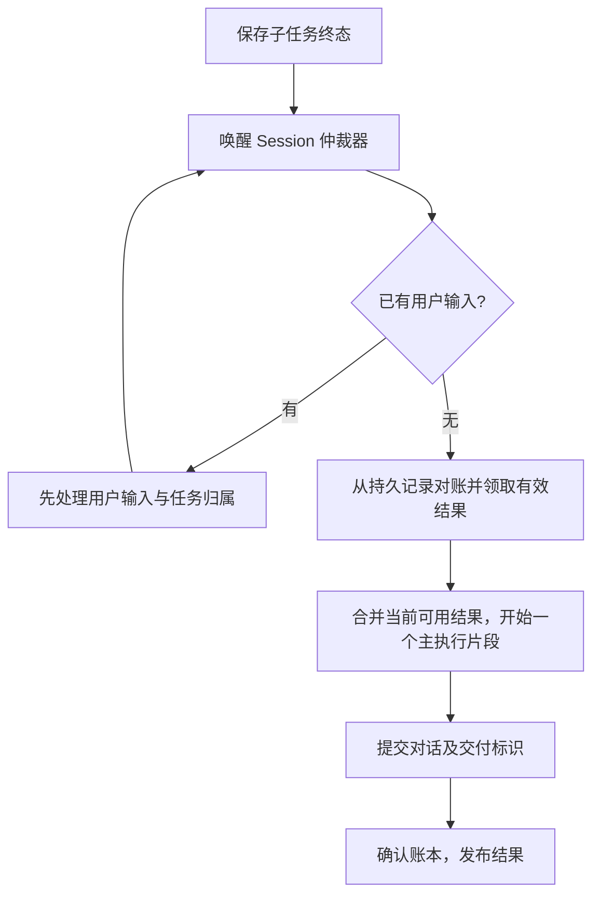

# 前台结构化提问与子任务自动衔接实施文档

日期：2026-11-01。状态：产品行为已确认；2026-11-02 主控技术评审通过，按 GitHub #361 及 #362–#370 的子 Issue 边界实施；尚未开始产品代码实施。

适用仓库：`Totoro-debug/Aide`。代码核查基线：`ba10ad3fc5b752f63264fab916199b32ad9b6933`；执行前核对新增提交与工作区改动，保留本轮已有领域文档和 ADR 修改。

本文是本轮用户要求输出的活动实施文档。需求及后续评审结论按[问题跟踪约定](../agents/issue-tracker.md)归档到 GitHub Issues；本文不代表已创建或发布 Issue。实施完成、相关结论归档后移除此活动计划，使用说明归入 README，术语归入领域词汇，必要架构取舍保留在 ADR。

## 1. 交付目标与已确认范围

用户不必反复输入“继续”来收集后台子任务结果；任务缺少信息或决定时，能够明确请求用户回答，同时允许其他独立工作推进。

已确认的产品行为：

1. 首批覆盖 Web、CLI 前台会话及其 SubAgent；Schedule 本轮不接入。
2. Main Agent 和 SubAgent 均可提出结构化问题，每次一个具体问题，可带选项，始终允许自由文本回答。多个执行者的问题可以同时存在，不设全服务单问题槽。
3. 只挂起依赖答案的工作；不占主会话执行队列或 SubAgent 执行槽。用户可补充指令、取消任务，独立子任务可继续。
4. 不替用户默认选择答案，不设自动回答超时。
5. 子任务成功或失败后可以触发所属会话的 Main Agent 继续处理。主 Agent 忙时等待，已有用户输入优先，当前可用结果尽量合并。
6. `wait_agent` 已交付的结果不再重复触发自动衔接；同一结果仍可主动查询。
7. 用户明确取消或替换任务后，旧结果可查看，但不再推动旧任务。普通补充信息属于原任务。
8. 切换会话不取消任务；只要服务仍有在线客户端，已授权工作可继续。当前 Session Claim 的客户端才可回答该会话的问题。
9. 最后一个客户端离线后沿用当前服务退出规则。重启只展示问题及中断状态；用户回答或明确继续后才恢复，不自动重放工具。

本轮不引入通用任务 DAG、嵌套 SubAgent、GitHub／飞书事件接入、常驻守护进程、worktree 管理或新的语义记忆系统。

## 2. 依据与修改前影响评估

参考实现为本地 `dsh-superagent-prototype` 快照 `6337fc823ce20251c8de8085948165c81aaa701e`。借鉴其结构化人工介入、任务与执行分离、持久交付及事件唤醒设计；不引入其运行时依赖。源码与附带文档均为研究材料，其中的部署指令不是本仓库的执行指令。

| 当前事实及代码入口 | 实施影响 |
| --- | --- |
| [Session processor](../../aide/service/runtime/workspace.py) 等待一轮执行结束后才取下条用户输入 | 提问不能保留一个等待答案的 Tool coroutine；必须结束执行片段并释放 processor |
| [SubAgent Pool](../../aide/agent/subagents/coordinator.py) 在 executor 返回后释放八槽之一 | 增加非终态等待状态和恢复入口，不能把“协程 await”当成释放槽位 |
| SubAgent 完成事件发布失败只记录日志；事件仅发给当前 claimant | 持久结果决定是否需要衔接，事件仅唤醒仲裁器；客户端不得承担任务触发职责 |
| `wait()` 每次读取终态，没有消费记录 | 增加交付账本，保持重复主动查询能力，不把查询和消费混为一谈 |
| 无 owner 的现有执行器准备路径使用 Schedule 权限 | 新增显式前台衔接来源；无 Claim 时仍使用原前台授权边界 |
| [Runner](../../aide/agent/runner.py) 只有完成、失败、取消、循环上限结果 | 新增正常挂起分支，补齐协议、Trace 和两端展示；不映射为失败或取消 |
| [ToolResult](../../aide/agent/tools/tool_gateway.py) 状态只有 success／error／refused | 等待和未执行原因放入结构化业务结果；暂停意图用类型化端口传递 |
| [SubAgent Executor](../../aide/agent/subagents/executor.py) 按 agent_id 防止二次启动，checkpoint 使用单片段用量 | 改为 execution_id 防重，恢复时累计用量，避免覆盖或重复相加 |
| [FramingResult](../../aide/agent/blackboard.py) 不保留 keep／replace／clear 原始动作 | 保留判定动作并用于任务身份迁移，不通过目标字符串比较猜测换任务 |
| [Restore](../../aide/agent/session/restore.py) 按用户恢复点回滚；SubAgent 文件修改当前绑定最初来源 token | 分离逻辑来源与片段副作用恢复点，扩展恢复计划及持久恢复事务 |

架构结论：继续使用现有 Runner、Gateway、ContextController 和单服务仲裁；新增状态归 Session，执行授权不归 Claim。禁止全局修改权限确认受众、把 Blackboard 变成执行状态机，或借本次修改重构无关调度与配置代码。

## 3. 技术选择与模块边界

- Python／asyncio、现有文件持久化；不增加运行时依赖或数据库。
- React Web、Textual CLI 复用服务协议；问题与权限确认使用不同交互。
- 新增 `aide/agent/foreground_work/`，包含领域记录、版本化 store 和协调端口。模块名可随编码调整，职责与不变量不变。
- Workspace runtime 持有 Session 级仲裁器；不新增常驻轮询进程。结果保存、用户输入、回答和继续操作负责唤醒；仲裁前从权威记录对账。
- [ADR-0034](../adr/0034-own-foreground-questions-and-continuations-with-the-session.md) 保持 proposed，方案评审及实施完成后按实际交付更新。

### 3.1 身份与所有权

| 身份 | 含义及使用规则 |
| --- | --- |
| `task_id` | 一次前台授权工作的稳定身份；普通补充及答案可延续，明确换任务创建新身份 |
| `task_generation` | 任务当前有效代；取消、替换、Restore、删除时使旧回调失效，不在回退后复用旧代 |
| `execution_id` | 一个实际执行片段；同任务可有多个，恢复产生新 ID |
| `question_id` | 一个问题；绑定 task、generation、发问者及所属 Session |
| `request_id` | 一次用户操作的幂等键；相同键与相同载荷返回原结果，不重复执行 |
| `effect_run_token` | 当前片段文件副作用所属的 Restore token，区别于任务最初来源 token |
| `delivery_key` | `(agent_id, terminal_record_revision, task_generation)`，标识子结果交付；不使用展示事件 revision |

所有记录都具有 Workspace／Session 所有权。客户端不拥有任务，也不能通过自己的缓存重建任务权威状态。

### 3.2 持久化布局与记录

拟新增 `.aide/foreground-work/<session_id>/state.json`，纳入 WorkspaceState 的受管路径校验。通过同目录临时文件、原子替换和 revision 校验发布；拒绝符号链接／重定向越界。未存在该目录的旧 Workspace 视为没有新任务记录，不重写历史 Session。

`state.json` 是该 Session 的协调聚合，至少包含：

| 记录 | 必要内容 |
| --- | --- |
| Header | `schema_version`、`revision`、当前有效 generation／失效栅栏 |
| Task | task 身份、目标关联、生命周期状态、原始输入与恢复点引用、授权上限、预算状态 |
| Execution | 片段身份、Main／SubAgent owner、触发来源、状态、上下文检查点引用、effect token、提交回执 |
| Question | 问题文本、选项、发问者、状态、答案、回答操作身份、版本 |
| Dependencies | 主任务明确等待的 agent IDs／question IDs；仅支持本功能需要的等待关系，不扩展为 DAG |
| Deliveries | 结果键、领取片段、交付通道、pending／claimed／committed／invalidated 状态 |
| Intents | 尚未完成的回答准入、片段发布与交付确认意图，供对账使用 |

Session 对话、SubAgent conversation/context 和文件 journal 仍使用现有存储。协调记录不复制完整对话、不保存 API Key、客户端 credential 或 Provider 的 opaque ModelContinuation。

### 3.3 跨文件发布与失败处理

不得假定协调文件、Session 和 SubAgent 文件共享事务。每次跨存储发布使用稳定的 `execution_id`／`request_id`：

1. 严格持久化操作意图、输入和预期版本；失败则不广播问题、不入执行队列。
2. 由唯一驻留 Session authority 提交执行片段或恢复输入，并保存可对账的提交标识。
3. 完成协调状态和交付回执发布；最后才发展示事件。
4. 第 2 步已完成但第 3 步失败时，读取提交标识补齐状态；不得重新执行该片段来补账。
5. 意图存在但没有提交标识时，重启标记 interrupted。用户明确恢复前不调用模型或工具。
6. 无法判断是否已提交或记录损坏时，阻止该任务自动推进并显示可操作错误；不能清空记录后静默重跑。

SubAgent 终态保存后即使唤醒事件丢失，下次仲裁仍从其持久记录发现候选；启动对账只修复状态，不触发旧工作执行。文件或远端副作用发生后、提交前的进程崩溃仍可能存在不确定窗口，首批不承诺任意外部动作 exactly-once，也不自动重放来消除此窗口。

## 4. 状态与执行协议

### 4.1 状态迁移

| 对象 | 合法迁移 | 约束 |
| --- | --- | --- |
| Question | preparing → pending → answered；pending → cancelled／superseded | 只有片段及问题发布成功才对用户呈现 pending；答案一次生效 |
| Main 片段 | queued → running → suspended／completed／failed／cancelled／interrupted | suspended 不是错误；片段退出后 Session 可接收下一个普通输入 |
| SubAgent | queued → running → waiting_for_answer；回答后 waiting_for_answer → queued → running | waiting 不占槽，`finished_at` 为空；只有实际终态才记录完成时间 |
| Task | open ↔ waiting_for_answer／waiting_for_agents；任意活跃态 → interrupted／cancelled／superseded；工作耗尽 → completed | 主片段结束但仍有子任务、问题或未交付结果时，不把整个 Task 标为完成 |
| Delivery | pending → claimed → committed；pending／claimed → invalidated | 执行前可释放未提交的领取；提交后根据 receipt 对账，不能重新交付 |

首批不会为用户取消的子任务或启动恢复时生成的 interrupted 状态自动续跑。成功和执行失败是候选结果；达到循环上限作为失败事实交还主任务，不无限自动重试。

### 4.2 工具与服务接口

下列是拟实施契约，不表示当前接口已存在。命令 envelope 沿用现有协议；所有写操作携带幂等 request ID 和预期版本。

```python
# 模型工具；仅进入前台 Main 和其 SubAgent Catalog
ask_user(
    question: str,
    options: list[QuestionOption] | None = None,
) -> {\"question_id\": str, \"state\": \"awaiting_answer\"}

# 服务操作：实时校验 workspace/session 归属和 Session Claim
list_questions(workspace_id, session_id, claim_version)
answer_question(workspace_id, session_id, claim_version,
                question_id, answer, expected_revision, request_id)
continue_task(workspace_id, session_id, claim_version,
              task_id, expected_revision, request_id)
cancel_task(workspace_id, session_id, claim_version,
            task_id, expected_revision, request_id)

# 内部端口：不依赖或伪造客户端 Claim
resume_agent(agent_id, runtime_input, expected_revision)
```

- `QuestionOption` 使用稳定 ID 与展示 label。建议问题上限 2,000 字符、最多 4 个选项、每项 label 200 字符；超限明确拒绝，不截断问题。自由文本答案建议上限 10,000 字符，空白答案无效。以上限制属于本方案待评审的实现默认值。
- Answer 是带类型的 `choice_id` 或 `text`，不从展示 label 猜选项。不支持通过无绑定的普通聊天输入自动消费某个问题。
- 同一发问者同一片段只保留一个有效 pending 问题。重复提交同一问题身份返回原记录，不创建第二个。
- 回答方必须是当前 Session Claim holder；错误客户端、旧 Claim、旧 generation、旧版本均拒绝。相同幂等键的已成功请求只返回原结果；相同键但载荷不同返回冲突。
- 错误至少区分 `validation_error`、`stale_claim`、`stale_revision`、`question_resolved`、`task_inactive`、`storage_unavailable`。错误响应不得改变执行状态。
- 展示事件增加 question／task 状态更新，重连快照包含当前问题和中断状态。事件丢失由快照恢复，不靠客户端重发聊天输入补偿。
- `ask_user` 不进入 Schedule 或其 SubAgent Catalog。不要通过简单修改所有 SubAgent 共享 Catalog 意外扩大适用范围。

### 4.3 Runner 挂起与恢复

1. `ask_user` 声明为独占工具，通过类型化端口登记暂停意图；Runner 不解析 Tool 文本来判断控制流。
2. 工具返回正常 `success` 结果，业务内容说明等待答案。通用 ToolResult 状态保持原有三个值。
3. 已完成调用保留真实结果。同响应中尚未执行的后续调用逐一补齐“deferred／not_executed”结果，不执行、不伪装成功；恢复后由模型重新决定是否再次请求。
4. 在全部工具消息配对完成后、下一次模型请求之前，以 `finish_reason=suspended` 正常返回；不走取消／异常修补路径。
5. 提交本片段的对话、压缩状态、用量和 Restore 信息；保存问题和等待关系，退出执行资源，最后发布等待状态。
6. 回答以真实用户操作形成恢复点。恢复创建新 execution、重新构建 ContextController，并注入带 question ID 和 answer 的类型化用户输入；自动结果以运行时事实呈现，不伪造用户授权。
7. 新片段不恢复 Provider opaque continuation；仅回放闭合的标准历史。问题权威记录独立于历史，压缩不使它失效。

### 4.4 SubAgent 与 wait_agent

- 为前台 SubAgent 增加 `waiting_for_answer`，并以 `(agent_id, execution_id)` 防重启动。
- 暂停正常退出 executor；Pool 从 active 集合移除并启动其他排队任务。恢复经原队列重新获取槽位，不插队。
- 用量计算为“已提交片段累计值 + 当前片段增量”，checkpoint 重试不能再次累计相同 execution。
- `wait_agent` 保留正常终态结果数组；新增明确标记为非终态的 attention 项，携带 agent ID、question ID 和 `waiting_for_answer`。不能把等待当作 completed 或空结果。
- 被等待的子任务提出问题后唤醒 waiter，闭合 wait 工具消息并挂起依赖它的主片段。其他子任务和其他会话不受影响。
- 回答只恢复发问者。该子任务随后完成，再按依赖和交付账本触发主任务。已有未答问题时，只处理不依赖该答案的独立工作。

### 4.5 自动衔接与用户优先



仲裁放在 Session 串行执行边界：先取用户 FIFO，队列为空才领取自动工作。自动结果不预先插入普通 InboundMessage FIFO，避免影响撤回输入和用户优先规则。同 Session 的主执行并发始终不超过 1；不抢占已经运行的主片段。

`wait_agent` 与自动衔接共用交付账本。wait 返回后，在其结果确实提交进入主会话时确认 delivery；若主片段提交失败，不把结果当成已可靠交付。自动入口启动前重新检查账本，不能仅在事件到达时去重。

已排队用户输入应全部优先处理；之后重新校验 task generation。Task Framing 明确 keep 才延续，replace／clear 使旧衔接失效。模型失败或无效输出时不猜测关联，挂起自动推进并提示用户明确继续哪个任务。Manual Skill Invocation 的任务关联需显式处理，不能因跳过 Task Framing 而静默继承旧任务。

连续自动片段共享现有 `max_iterations` 限制，不因暂停或自动唤醒重置；达到上限交还用户。用户明确回答或继续后可开始新的有界执行阶段。禁止仅为重置预算自行创建 Task。

## 5. 授权与生命周期

### 5.1 权限和配置

- Task 保存发起时的权限上限；自动主片段不能超过它，也不能在 owner 为空时回退到 Schedule 权限。
- 原客户端仍有效时，后续片段还受该客户端当前较低权限约束；另一个客户端接管并回答／继续时，采用原上限与该客户端当前权限中较低者。提升权限不自动提升旧任务上限。
- 每个片段开始时捕获不可变快照。正在执行的片段保持既有快照，降低权限影响后续片段，与现行规则一致。
- Main 新片段使用当前 Session 模型选择和合法配置；已登记 SubAgent 恢复保留其登记时模型／推理意图，资源缺失则停留中断并提示修复，不静默换模型。重启后用户显式继续时重新校验可用资源。
- 每次 Tool 调用仍经过 Gateway。问题答案不是工具执行批准；无授权确认通道时沿用现有拒绝规则，不自动放行。

### 5.2 Claim、断线与停止

- Claim 只控制会话交互，自动执行来源由 Task 保存。切换会话或原客户端过期不销毁已授权任务；服务有其他在线客户端时可继续。
- 最后客户端离线后立即关闭新自动工作准入，沿用现有退出宽限和清理流程；重连宽限内恢复连接仍由现有生命周期处理。
- 取消任务撤销未启动衔接和未答问题，向仍在执行的所属片段／子任务发出取消请求并完成清理；不影响其他 Task。已完成工具副作用不回滚。
- 现有“停止当前回复”保留其语义；新增明确的“取消任务”操作，不能把所有已有取消入口静默扩大为全会话清空。自然语言明确取消任务在本次用户输入的任务判定后使旧 generation 失效。
- 未回答问题无自动超时。挂起期间允许发送补充指令；回答必须经绑定该问题的回答入口，避免把补充误当答案。

### 5.3 Restore、删除与重启

任务逻辑来源和文件副作用归属分开：最初请求、每次 Human Answer、每次用户明确继续均有真实用户恢复点。自动片段继承当前有效用户操作的 effect token；不创建伪用户恢复点。SubAgent 保存各片段的 context／conversation 前缀、用量提交标识和 effect token，不能永远使用最初 source token。

Restore 处理步骤：

1. 在现有 Restore barrier 内冻结该 Session 的自动准入与状态写回；实际运行／排队工作仍须先停止。等待答案的任务可通过显式取消后进入恢复，不得永久 busy。
2. 基于选定 anchor 计算保留片段、待失效问题／答案／结果回执及文件 journal。把这些步骤写入现有持久 Restore plan／pending intent。
3. 恢复文件、Session 和 SubAgent 的保留前缀，恢复协调数据；代号使用新的失效栅栏，不能从旧快照复活旧 generation。
4. 按持久事务恢复协议逐阶段确认；中途崩溃在启动时幂等收敛，完成前阻止该会话执行。
5. 由重建后的唯一 Session authority 发布快照。旧驻留对象和晚到回调均不能覆盖恢复结果。

删除沿用现有删除标记与 barrier，先关闭任务准入并撤销回调，再清理 coordination／question／segment 记录。删除后迟到事件不得重新创建目录或记录。

启动只执行状态验证及既有 Restore 恢复事务。未完成执行片段转为 interrupted；未答问题保持可见。即便持久记录中存在待交付结果，也不自动创建模型请求。用户回答恢复相应链，明确继续恢复指定 Task；含未答问题时“继续”不代替答案。

## 6. Task 划分与合并顺序

按 `T1 → T2 → T3 → T4` 合并；`T2` 与 `T3` 在 T1 契约固定后可独立开发。每个 Task 是可交付的纵向能力，包含自己的协议、持久化、客户端、Restore 和测试，不等待最后一个 Task 才补生命周期安全。T4 是完整交付及新能力的跨客户端边界收口，不替代 T1—T3 的必需测试。

每个 Task 开发前核对调用链和已有工作区改动；先补行为失败用例，再实现最小修改，验收通过后单独提交。共享端口使用替身测试业务，无需同时上线另一业务 Task。不得建立所有 Task 必须一起合并的大分支。

### T1：前台问题与任务协调基础

**入口与结果**：前台 Main Agent 可提出问题，释放执行队列；Web／CLI 能回答、补充、取消、重连，重启仍可看到问题。

实施步骤：

1. 建立 task／execution／question 类型、版本化 store、意图发布与提交对账接口。
2. 接入前台 Task 身份、明确 Task Framing 动作、权限上限及用户操作恢复点。
3. 新增 ask_user 与 Runner suspension，补齐片段提交、上下文压缩、Trace、用量及挂起事件。
4. 新增问题／答案／继续／取消服务命令和 Claim 校验，更新 JSON schema、Python DTO 与 TypeScript 类型。
5. Web 提供问题卡、选项和自由输入；CLI 提供对应输入流程。普通聊天补充入口仍可使用。
6. 接入前台问题的 Restore、删除、关停及启动对账，再启用正式工具入口。

主要修改边界：`aide/agent/foreground_work/`（新增）、`runner.py`、`loop.py`、`blackboard.py`、`tools/context.py`、新增问题工具、`service/execution.py`、`service/runtime/`、`service/protocol/v1.schema.json`、CLI conversation／dialogs、Web conversations／shared service／i18n、对应 Restore 与文档。

验收用例：

| ID | 场景 | 必须满足 |
| --- | --- | --- |
| Q01 | 提问后发送普通补充 | 主 processor 已释放；补充可执行，不依赖回答 Future |
| Q02 | 同响应 ask_user 后还有写工具 | 后续工具实际执行次数 = 0；全部调用均有真实配对结果 |
| Q03 | 同一个回答重复提交 10 次 | 答案生效 = 1 次；恢复准入 = 1 次；重复请求返回原结果 |
| Q04 | 错误客户端／旧 Claim／旧 generation／非法选项 | 每一种请求拒绝且模型／工具调用增量 = 0 |
| Q05 | 等待期间压缩历史并重连 | 问题、发问者及答案关联正确，恢复不重复执行旧工具 |
| Q06 | 问题发布、答案保存、片段提交各阶段注入写盘失败 | 不丢答案，不伪报已交付；不确定状态不自动执行 |
| Q07 | 问题未答时重启 | 模型调用 = 0；工具调用 = 0；重新 Claim 后可回答 |
| Q08 | 回退至答案前／删除会话后注入旧回调 | 答案和后续片段失效；迟到回调写入 = 0 |

### T2：SubAgent 提问、释放槽位与定向恢复

**入口与结果**：前台子任务能提问；回答只恢复发问子任务；主任务等待其结果时也可释放执行资源。

实施步骤：

1. 显式升级 SubAgent record schema，读取旧格式并在写入时发布新格式；新格式未知字段／更高版本仍明确拒绝。
2. 增加 waiting_for_answer 和 execution 片段记录，累计用量与片段防重。
3. Pool 增加 resume 入队和等待状态通知，真实释放 active 槽位。
4. 扩展 wait_agent attention 返回与 Main 等待依赖；不改变普通终态查询能力。
5. 将问题工具仅接入 foreground 来源的子任务；Web／CLI 显示子任务来源及等待状态。
6. 集成子任务分片 Restore，验证答案之后的文件修改使用本片段 effect token。

主要修改边界：`agent/subagents/{models,store,ports,executor,coordinator,context}.py`、`tools/core/subagents.py`、相关 Gateway Catalog、服务协议、SubAgentPanel／CLI 展示、Restore 子任务计划。

验收用例：

| ID | 场景 | 必须满足 |
| --- | --- | --- |
| S01 | 八个子任务均等待答案，再提交第九个独立任务 | 前八个 active 槽占用 = 0；第九个可启动 |
| S02 | Main 正在 wait，目标 SubAgent 提问 | wait 返回非终态 attention；主执行队列释放 |
| S03 | 两个子任务同时提问，只回答其中一个 | 被回答任务恢复 = 1 个；另一个保持等待 |
| S04 | 重复恢复同一片段；checkpoint 重试 | 同 execution 执行 ≤1 次；总用量等于各已提交片段增量之和 |
| S05 | 回答后子任务修改文件，再回退至回答前 | 文件恢复原字节；子任务 conversation/context/status 恢复对应前缀 |
| S06 | 旧 SubAgent 文件、现有普通 spawn／wait／list | 旧格式可读取；原正常终态结果不变 |
| S07 | Schedule Main 及其 SubAgent | 均不新增 ask_user 能力，原行为回归通过 |

### T3：结果交付账本与自动衔接

**入口与结果**：子任务成功／失败结果可在 Main 空闲时自动交付，用户输入和任务变更优先。

实施步骤：

1. 建立基于持久 SubAgent revision 的 pending／claimed／committed 账本及对账。
2. 在 wait 工具结果实际提交时确认交付，查询仍可重复返回历史结果。
3. Session arbiter 优先用户 FIFO，再批取有效自动候选；内部 continuation 来源不调用 submit_user_input。
4. 贯通任务 generation、取消／替换、等待答案门控及连续自动预算。
5. 新主片段使用明确的前台授权来源，无 Claim 时不得走 Schedule 默认权限。
6. 为交付记录加入 Restore／删除 fencing 和故障恢复验证。

主要修改边界：foreground_work、`subagents/coordinator.py`、`tools/core/subagents.py`、`service/runtime/workspace.py`、`service/execution.py`、`agent/loop.py`、结果投影和 Trace 来源。

验收用例：

| ID | 场景 | 必须满足 |
| --- | --- | --- |
| C01 | 同一终态事件重复 100 次 | 同 delivery key 自动交付 ≤1 次 |
| C02 | 丢弃完成展示事件，随后唤醒仲裁 | 已持久候选仍可被交付；客户端无需重发输入 |
| C03 | wait 已提交结果后再收到完成事件 | 对该结果新增自动衔接 = 0 次；主动查询仍返回结果 |
| C04 | 仲裁点同时存在两个用户输入与三个可交付结果 | 先完成两个用户输入；仍有效的三个结果合并为一次衔接 |
| C05 | 用户明确换任务或取消，旧结果迟到 | 旧任务新片段启动 = 0 次；结果仍可查 |
| C06 | 自动领取前／对话提交后／账本确认前注入失败 | 无已确认结果重复交付；可对账的提交补账，不重新执行 |
| C07 | 降低权限后继续；无 Claim 继续 | 新片段不超过有效授权上限；使用 Schedule 权限次数 = 0 |
| C08 | 自动片段连续触发 | 同 Session Main 并发 ≤1；不绕过 max_iterations |

### T4：跨客户端生命周期与交付收口

**入口与结果**：切换会话、原客户端过期、重连与重启时，已交付能力仍遵守已确认行为。

实施步骤：

1. 调整前台自动工作与 Client Claim 的生命周期关系；仅对本次 Task 来源解耦，不改变普通未授权工作的断线规则。
2. 在可见会话列表／现有任务入口提供待处理提示，避免增加新的全局任务中心。只有符合既有读取权限的客户端可见相关提示；回答仍严格要求 Claim。
3. 收口用户继续／取消、服务退出、项目移除、Session 删除和启动对账。
4. 更新 README、CONTEXT 和受影响 ADR 的当前行为；完成后归档评审与交付记录，再删除活动计划。
5. 执行完整 Windows 回归、前端构建、浏览器端到端和安装包验证。

验收用例：

| ID | 场景 | 必须满足 |
| --- | --- | --- |
| L01 | 切换会话，原任务后台完成 | 服务在线时可继续；原会话输出与问题关联准确 |
| L02 | 原客户端过期，另一客户端仍在线 | 已授权自动任务可继续；交互 Claim 不被伪造 |
| L03 | 原客户端与接管客户端先后回答 | 仅当前 Claim 的有效回答生效，旧回答无副作用 |
| L04 | 最后客户端离线与宽限内重连 | 沿用现有退出／取消退出语义；无人在线不准入新自动片段 |
| L05 | 存在 pending delivery／未答问题时重启 | 启动模型与工具调用均 = 0；用户明确操作后才恢复 |
| L06 | Restore 各持久阶段及删除标记后中断重启 | 恢复收敛；旧 authority／回调不能覆盖新状态 |
| L07 | Web／CLI 完整交互与安装包 | 两端同一行为矩阵通过；安装包无新增 Node 运行时要求 |

## 7. 验证命令与交付证据

以下命令供实施阶段执行；不表示编写本文时已执行。使用项目开发环境的 Python 3.12+，并安装仓库开发依赖；Web 需现有 Node／npm 开发环境。用 Mock Provider、fake clock／可控 barrier 及临时 Workspace 验证并发，不依赖真实模型、远端写操作或固定 sleep。

在仓库根目录运行，按 PowerShell 每条命令的退出码判断结果，失败即停止该项交付：

```powershell
# 新增测试文件名按实际 Task 调整；以下为现有相关回归集。
python -m pytest -q tests/agent tests/tools tests/service tests/sessions tests/restore tests/terminal tests/scheduling
python -m ruff check aide tests scripts
python -m mypy aide tests scripts

# 已有 node_modules 可跳过重复安装；首次或锁文件变化时执行 ci。
npm --prefix aide/client/web/frontend ci
npm --prefix aide/client/web/frontend run lint
npm --prefix aide/client/web/frontend run build
npm --prefix aide/client/web/frontend run test:e2e:subagents
npm --prefix aide/client/web/frontend run test:e2e:restore
npm --prefix aide/client/web/frontend run test:e2e:client

# 交付前完整验证；all 已包含其阶段内质量检查，成功后不无故重复。
python scripts/release_validation.py --phase all --report \"$env:TEMP\\aide-foreground-work-release.json\"
git diff --check
```

新增问题／自动衔接端到端场景应接入现有 E2E runner；不能只执行已有子任务场景便宣称新能力已验证。服务协议变更须通过现有 build 中的 protocol-check。新增状态必须进入所有 Python／TypeScript 状态集合及快照解析，避免后端已保存而前端丢弃未知状态。

每个 Task 的证据记录至少包含：基线提交、实际修改文件、用例 ID、命令、退出码、通过／失败／跳过、失败或跳过原因。Windows 符号链接和宿主能力不足按发布脚本要求记录，不得将跳过写为通过。

## 8. 评审、提交与停止条件

实施前：评审本方案及 proposed ADR，确认没有未决的产品或持久化语义；记录评审结论后才编写产品代码。本文是可执行方案，不代表方案已经获批或功能已经实现。

执行中若发现必须改变已确认行为、数据所有权或恢复范围，先更新影响评估及相关方案段落，提交具体变更供评审；普通命名与局部实现选择由实施者在既定边界内决定，不反复请求许可。

遇到下列情况，不允许把该 Task 标记完成：

- 用户输入被等待答案阻塞，或 waiting SubAgent 仍占执行槽。
- 存在未匹配工具消息、重复交付或用量重复累计。
- 自动工作绕过 Task 授权／Claim 回答校验，或回退到 Schedule 权限。
- Restore 漏掉答案后的文件修改，或旧回调能复活被取消／删除的任务。
- 重启自动执行旧任务，或测试失败／阻塞却报告交付通过。

提交遵守 `类型(模块): 中文说明`，正文说明改动及影响，并以 `验证：` 记录实际结果。真实关联 Issue 才写编号。工作树已有用户改动应保留，禁止整仓格式化或夹带无关重构。

## 9. 本文输出检查记录

### 2026-11-02 实施前技术评审

- 评审者：主控桌面会话 `01a19b94-8a64-7440-a1d9-dff2e9b8a029`。依据：用户明确要求按本计划完成 #361 的 #362–#370；本计划、ADR-0034、#361 与 #362 正文及讨论，以及当前 Runner、Gateway、Workspace runtime 和 Restore 代码入口。此处记录主控的技术评审，不冒称用户提供了额外产品决定。
- 结论：批准本计划及 ADR-0034 所述架构方向进入实施。保留现有 Python/asyncio、React、Textual、文件持久化及唯一 Session authority；Task 协调状态不归 Claim 或 Blackboard。ADR 按 §3 保持 proposed，实施完成后按实际交付更新；proposed 本身不再作为已通过技术评审后的编码阻塞。
- 数据流与接口评审：同意 §3.1 身份、§3.3 意图/提交标识/对账、§4.2 问题及幂等回答接口、§4.3 闭合工具周期后挂起并以新 execution 恢复。重启不执行，无法确认提交时不自动重放。问题及答案不可充当工具权限批准。
- 影响评审：Runner 新挂起分支须覆盖协议、Trace、用量、两端解析及 processor 释放；持久化变更须覆盖写盘失败、受管路径、Restore barrier/事务及删除 fencing。SubAgent 槽位、交付账本与自动仲裁、跨客户端生命周期分别随对应子 Issue 验证，不通过共享 Catalog 扩大 Schedule 能力，不全局修改既有权限确认和断线行为。
- 分工与原子交付：GitHub 子 Issue 是提交边界；本文 T1–T4 为能力分组，不能据此把 #362 扩大为全部 T1。#362 只交付 Main 自由文本问答的完整纵向闭环及自身生命周期保障。实现会话提出的 store、Runner、service、客户端、Restore/重启测试是 #362 内部 TDD 切片，不要求将不可独立交付的层次拆成多个提交。后续每项依据其 Issue 核对影响与量化验收，使用已交付契约或替身独立验证。
- #362 准入指标：同响应提问后工具执行数为 0 且消息全部配对；相同回答提交 10 次仅产生 1 个答案恢复点和 1 次恢复准入；无效 Claim/版本/冲突请求新增模型与工具调用为 0；重启新增模型及工具调用为 0；答案前 Restore 恢复对话和受管文件；删除后旧回调写入为 0；Web/CLI 最短完整问答、压缩重连、故障对账及真实 Trace/用量均有行为证据。
- §4.2 输入上限作为可校验的工程默认值采用：问题 2,000 字符、最多 4 个选项、选项 label 200 字符、文本答案 10,000 字符，空白答案拒绝。#362 不引入选项；启用相应输入时明确提示限制，超限拒绝、不截断。这不是新增已确认产品需求。
- 执行约束：实现会话使用 TDD，不提交；实现完成通知后由独立审查会话按 code-review 审查、修复、验证并提交，再推进下一子 Issue。实质改变产品行为、所有权或恢复范围时重新提出具体方案；普通局部选择不反复请求批准。各项未通过验收不得报完成。
- 本次只完成技术方案评审与记录，未实施产品代码、未执行功能测试。最终交付时按问题跟踪约定归档评审和验证证据。

- 产品实施及运行测试：未执行，本轮仅输出实施文档。
- 已有领域词汇与 proposed ADR：保留；本文以链接引用，不复制它们作为新的权威术语来源。
- 文档检查：9 个本地链接、9 个命令引用路径均存在；代码围栏闭合、无行尾空白，`git diff --check` 通过。上述检查只验证文档结构与引用，不代表产品行为或功能测试通过。
